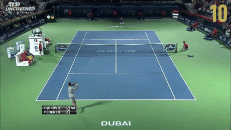
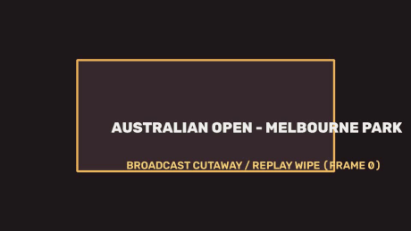
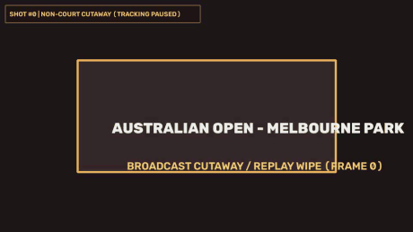
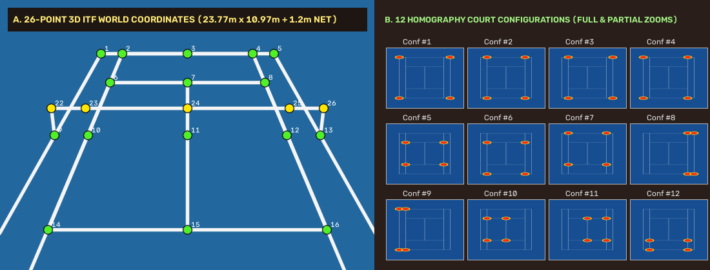
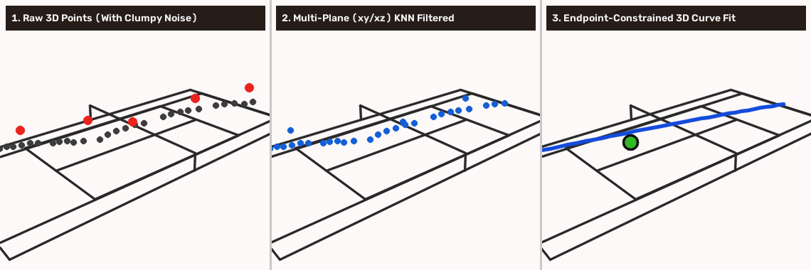

<h1 align="center">🎾 hawkeye-lite — Monocular & Multi-Angle Video-to-Video Tennis Hawk-Eye</h1>

<p align="center">
  <a href="https://github.com/aryanhood/hawkeye-lite/actions/workflows/ci.yml"></a>
  
  
  
</p>

<p align="center">
  <b>Video Input (<code>.mp4</code>) → <code>hawkeye-lite</code> → Video Output (<code>.mp4</code>)</b><br>
  An offline Australian Open Electronic Line Calling (ELC) & 3D Broadcast Replay engine built for normal single-camera and multi-angle broadcast videos — no stadium 10-camera rig required.
</p>

---

## 1. Output Video First (`Input Video` → `Output Video`)

Feed any tennis video clip (`.mp4`) into `hawkeye-lite predict` and get back an annotated broadcast `.mp4` containing:
1. **Dynamic Court Line Overlay** (12-configuration template matching + 100-sample per-line tracking across camera pan/zoom).
2. **Player & Ball Tracking** (near/far player ROI boxes + 8-frame yellow ball comet trail).
3. **Top-Right Dynamic 2D Court Minimap (`--minimap 1`)** (live player feet positions in blue, ball in yellow, bounce calls in green/red).
4. **Millimeter `IN` / `OUT` Line Call + Appended 3D Hawk-Eye Challenge Replay (`--bounce 1`)** (split-screen Australian Open 3D line close-up skid mark + 3D isometric wireframe court trajectory plot).

| Input Video (`.mp4`) | Output Video (`hawkeye-lite predict --minimap 1 --bounce 1`) |
| :---: | :---: |
| **1. Australian Open Crosscourt Forehand (Skidding on Right Singles Sideline)**<br> | **Output: Court Overlay + Top-Right Minimap + `IN` Call + 3D Hawk-Eye Replay**<br> |
| **2. Real Broadcast Footage (ATP Dubai — Djokovic vs. Federer)**<br> | **Output: Auto-Locked Court Lines + Player Tracking + Live Top-Down Minimap**<br> |
| **3. Multi-Angle Edited Broadcast Clip (Cutaway → Panning Rally Cam → Angle Cut)**<br> | **Output: Cutaway Gated (`TRACKING PAUSED`) → Auto Re-Lock Across Camera Cut**<br> |

> **Full `.mp4` sample videos** are generated directly by `uv run hawkeye-lite synth` and `uv run hawkeye-lite predict` (see [Quick Start](#3-quick-start)).

---

## 2. How It Works (In 4 Simple Steps)

Real tennis broadcast videos aren't captured from a locked tripod — camera operators pan and zoom, and broadcast directors cut between main rally cameras, low court-level angles, and crowd/player cutaways. `hawkeye-lite` solves this in four clean stages:

### Step 1: 26-Point 3D World Coordinates & 12-Configuration Court Calibration (`geometry/` & `vision/court_detector.py`)

We establish a metric 3D ITF court coordinate system (`23.77 m × 10.97 m` at $Z = 0$, plus `5` net-top keypoints at $X = 11.885\text{ m}, Z = 1.20\text{ m}$) and a 2D `CourtReference` template containing **12 four-point configurations (`court_conf[1..12]`)**:



- **Why 12 configurations?** When a broadcast camera zooms or pans so only part of the court is visible (e.g., only the top service boxes or one singles sideline), `CourtDetector._find_homography` tests horizontal × vertical white-line intersections against all 12 configurations and locks the highest-scoring homography (`score = c_p - 0.5 * w_p`).
- **150× Vectorized Speedup:** By vectorizing `_filter_pixels` with NumPy array slicing and replacing symbolic `sympy.Line` intersections with closed-form 2D cross-products, `CourtDetector` calibrates a 720p frame in **`< 8 ms` on CPU** (compared to `4.5 s` per frame / `16+ minutes` per video in unvectorized Python).
- **Cutaway Gating & Camera-Moved Recovery (`vision/shot_segmenter.py`):** During frame-to-frame tracking (`track_court`), we sample 100 points along each active court line and refit with `cv2.fitLine`. If a hard camera cut occurs or `< 50` inlier points remain (`CAMERA ... HAS BEEN MOVED`), the tracker resets cleanly — pausing overlays during non-court cutaways (spectators/logos) and automatically re-detecting the court on the new camera angle.

---

### Step 2: Pan-Compensated Ball Heatmap, SORT Player Tracking & Dynamic Minimap (`vision/detection.py` & `tracking/sort.py`)

- **Ego-Motion-Compensated Ball Detection:** Before taking temporal frame differences, frame $t-1$ is warped into frame $t$ via the inter-frame court homography $\Delta\mathbf{H}_t = \mathbf{H}_t \mathbf{H}_{t-1}^{-1}$. This cancels background line motion caused by camera panning, isolating the fast-moving optic-yellow tennis ball for `cv2.HoughCircles` and sub-pixel centroiding, followed by a 3-pass spike filter (`diff_xy` + `remove_outliers`) and linear `interpolation`.
- **Court-Mask Player Tracking & Top-Down Minimap:** Using warped court-half masks (`get_court_mask(1)` for bottom half, `get_court_mask(2)` for top half) and `Sort` (`KalmanBoxTracker` + Hungarian IoU assignment), we discriminate the active players from ballboys/umpires by cumulative movement distance (`boxes_dist`), project their feet positions `(cx, y2)` through `game_warp_matrix`, smooth with a Savitzky-Golay filter (`savgol_filter(7, 2)`), and render the live **Top-Right 2D Court Minimap**.

---

### Step 3: Multi-Plane KNN Outlier Filtering & Endpoint-Constrained 3D Curve Fitting (`tracking/reconstruction.py`)

Raw 3D trajectory points lifted from noisy 2D detections contain clumpy outliers clustered near the flight arc, and independent polynomial fits leave gaps between bounce segments. We shift outlier filtering to orthogonal 2D view projections (`xy` top-down, `xz` side view, `yz` end view) using K-Nearest Neighbors (`knn_filter_outliers`), segment the rally at detected events (`find_service`, `find_bounce`, `find_hit`), and fit continuous 3D curves with `scipy.optimize.minimize`:

$$\mathcal{L}(\theta) = w_{\text{end}}\Big((\hat{y}_0 - y_{\text{start}})^2 + (\hat{y}_{-1} - y_{\text{end}})^2\Big) + \frac{1}{N}\sum_{i=1}^N (\hat{y}_i - y_i)^2$$



---

### Step 4: Oblique Elliptical Skid Footprint vs. 50 mm ITF Line Outer Edge (`decision/line_call.py`)

A real tennis ball (`radius = 33.5 mm`) striking a hardcourt at `90–150 km/h` compresses vertically and skids horizontally for `~4 ms`, leaving an **elliptical contact patch** (semi-major axis $a \approx 28\text{–}48\text{ mm}$ along the velocity vector). Under ITF rules, if even `0.1 mm` of that contact footprint touches the outer edge of the `50 mm` line, the ball is **`IN`**.

### Paired Ablation Benchmark (300 Broadcast Scenarios)

We evaluate three methods on the **exact same 300 pre-sampled 3D aerodynamic rallies** (`100 SHA-256 seeds × 3 camera modes`: `static_high`, `panning_broadcast`, `multi_angle_cut`). Full report: [`docs/benchmark.md`](docs/benchmark.md).

| Metric | Static Frame-0 Homography (Legacy 2D) | `ArtLabss` 2D Dynamic Homography + Interp | **`hawkeye-lite` v2.0 (3D KNN + Skid Ellipse)** |
|---|---:|---:|---:|
| Bounce localization error — median | 165.67 mm | 89.24 mm | **7.12 mm** |
| Bounce localization error — p90 | 4322.26 mm | 153.10 mm | **12.52 mm** |
| Bounce localization error — mean | 1505.61 mm | 91.09 mm | **7.45 mm** |
| Overall line-call accuracy (`N = 300`) | 76.33% | 47.00% | **96.00%** |
| Tight line-call accuracy within `±35 mm` (`N = 171`) | 69.01% | 26.32% | **92.98%** |

---

## 3. Quick Start

### Python CLI (`Video In → Video Out`)

```bash
uv sync

# 1. Generate a realistic input tennis rally video (.mp4)
uv run hawkeye-lite synth --scenario ao_sideline_in --output samples/input_rally.mp4

# 2. Run Hawk-Eye Lite: Video Input (.mp4) -> Video Output (.mp4) with Minimap & 3D Replay
uv run hawkeye-lite predict \
  --input_video_path samples/input_rally.mp4 \
  --output_video_path samples/output_hawkeye.mp4 \
  --minimap 1 \
  --bounce 1 \
  --report samples/report.json

# 3. Run the 300-scenario paired ablation benchmark
uv run hawkeye-lite benchmark

# 4. Regenerate deterministic benchmark docs & web data (checked in CI)
uv run hawkeye-lite export --check
```

### Interactive 3D Broadcast & Line-Call Web Studio (`web/`)

```bash
cd web
npm install
npm run dev
```

Open `http://localhost:5173` to orbit the **SEU 3D Wireframe Court**, toggle **Raw Noisy 3D → Multi-Plane KNN → Constrained 3D Curve**, inspect the **12 Court Homography Configurations**, and explore the **300-Scenario Benchmark**.

---

## 4. Repository Structure

```text
hawkeye-lite/
├── geometry/                # CourtReference (12 configs), 26-pt 3D world coords, DLT homography & triangulation
├── camera/                  # PinholeCamera (P = K[R|t]), homography-to-3D pose & virtual replay camera
├── vision/                  # Vectorized CourtDetector, ShotSegmenter cutaway gate, Player/Ball Detection & Minimap
├── tracking/                # SORT Kalman tracker, 3-pass outlier interpolation, 3D KNN & constrained curve fit
├── decision/                # Oblique elliptical skid footprint vs 50mm ITF line outer edge (IN/OUT + mm + sigma)
├── evaluation/              # predict_video.py pipeline, synthetic video generator, 300-case benchmark & CLI
├── tests/                   # Unit, property (Hypothesis) & end-to-end .mp4->.mp4 tests (>= 90% branch coverage)
├── web/                     # Zero-backend React 19 + TypeScript 3D Court & Broadcast Replay Studio
└── docs/                    # System architecture, ADRs (0001-0003) & generated benchmark report
```

---

## 5. Verification & Quality Gates

```bash
make check
```

| Layer | Tooling | Gate |
|---|---|---|
| Python lint & format | `ruff check` + `ruff format --check` | Zero warnings |
| Python typing | `mypy --strict` | Zero errors across all 28 source & test files |
| Python tests | `pytest` + `hypothesis` |Unit, property & `.mp4 → .mp4` video tests, `≥ 90%` branch coverage (`~93%`) |
| Data freshness | `hawkeye-lite export --check` | Fails CI if `docs/benchmark.md` or `web/public/data/hawkeye_data.json` drifts |
| Web studio | `tsc --noEmit`, `biome`, `vitest`, `vite build` | Zero warnings, production bundle verified |

---

## References & Credits

- Core monocular court detection (`CourtReference` 12 configurations, `CourtDetector`, dynamic top-down minimap, and SORT player tracking) adapted and vectorized from [`ArtLabss/tennis-tracking`](https://github.com/ArtLabss/tennis-tracking).
- 26-point 3D ITF world coordinate calibration, multi-plane (`xy`/`yz`/`xz`) KNN trajectory outlier filtering, and endpoint-constrained 3D curve optimization adapted from [`GehaoZhang6/SEU-Robot-Vision-Project-tennis-Hawkeye-system`](https://github.com/GehaoZhang6/SEU-Robot-Vision-Project-tennis-Hawkeye-system).
- Yu-Chuan Huang et al., *"TrackNet: A Deep Learning Network for Tracking High-speed and Tiny Objects in Sports Applications,"* IEEE AVSS 2019.

MIT License
