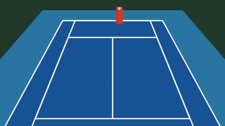
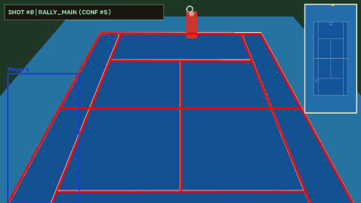
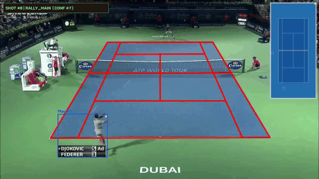

# hawkeye-lite — Court Calibration, Multi-View 3D Triangulation & Line Calling

**An offline sports-vision geometry and trajectory reconstruction engine.** Combines vectorized 12-configuration monocular court calibration for broadcast `.mp4` processing with calibrated multi-view Direct Linear Transform (DLT) 3D triangulation, multi-plane KNN outlier rejection, sub-frame ballistic impact solving, uncertainty propagation, and oblique elliptical skid-footprint `IN`/`OUT` line calling.

---

## 1. Two Distinct Operating Regimes

A core principle of this codebase is separating what a **single broadcast camera** can physically resolve from what requires **calibrated multi-view geometry**:

1. **Monocular Broadcast Video Pipeline (`hawkeye-lite predict`)**
   - Operates on single-camera `.mp4` input via vectorized 12-configuration court homography locking (`CourtDetector`), cutaway shot gating (`ShotSegmenter`), ego-motion-compensated optic-yellow HSV/motion ball detection (`ChromaMotionBallDetector` — explicitly a classical detector, not a neural network), `SORT` player tracking, top-right minimap rendering, and a monocular court-plane (`Z = 0`) bounce replay with explicit homography-Jacobian and out-of-plane parallax uncertainty bounds (`monocular_parallax_bound_m`).
2. **Calibrated Multi-View 3D DLT Reconstruction & Line Calling (`tracking/reconstruction.py`, `decision/line_call.py`)**
   - Given 2 to 4 calibrated camera streams `P_k(t)` (including panning/moving cameras), runs per-frame pairwise consensus DLT triangulation, rejects clutter spikes across three orthogonal 2D projections (`xy`, `xz`, `yz` KNN + temporal neighbor filtering), solves sub-frame ballistic intersection at `Z(t*) = r_ball` (`0.0335 m`), propagates combined `(J^T J)^-1` DLT + regression/timing covariance `(sigma_x_mm, sigma_y_mm)`, and evaluates the velocity-aligned elliptical skid contact patch against the 50 mm ITF line outer edge.

| Input Broadcast Video (`.mp4`) | Annotated Output (`hawkeye-lite predict --minimap 1 --bounce 1`) |
| :---: | :---: |
|  |  |
|  |  |
|  |  |

---

## 2. Geometry & Physics Pipeline


- **Vectorized 12-Configuration Homography (`vision/court_detector.py`, `geometry/court_reference.py`):** Evaluates visible horizontal/vertical court-line intersections across 12 four-point configurations when broadcast pan/zoom crops part of the court. Vectorized pixel filtering and closed-form 2D cross-product line intersections calibrate a 720p frame in milliseconds on CPU.
- **Consensus Multi-View DLT + 3-Plane KNN (`tracking/reconstruction.py`):** Triangulates per-frame camera subsets to reject single-camera outliers before full-set SVD triangulation, then applies orthogonal `xy`/`xz`/`yz` KNN and temporal neighbor checks to isolate true ballistic arcs from clutter spikes.


- **Sub-Frame RK4 Simulation & Skid Footprint (`decision/line_call.py`):** Aerodynamic drag + Magnus spin integration uses exact sub-stepped contact interpolation at `Z = r_ball`. At impact, an oblique elliptical contact footprint along the horizontal incident velocity direction tests minimum signed overlap against the ITF 50 mm outer line boundary, returning a calibrated Gaussian/normal-CDF `P(IN)` using the lateral uncertainty `sigma_mm`.

---

## 3. Honest 300-Scenario Benchmark (2D Pixel Observations Only)

Every method is evaluated across **100 SHA-256 seeds × 3 camera modes** (`static_high`, `panning_broadcast`, `multi_angle_cut` — `N = 300` total rallies, `N = 242` tight calls within `+/-35 mm` balanced at `49.6%` ground-truth `IN`) operating **strictly from noisy 2D pixel coordinates** (`sigma = 1.0 px` Gaussian jitter + `6%` random `+/-80 px` clutter spikes per view). No method receives oracle 3D points, oracle bounce frames, or oracle velocities, and all primary rows use the same ITF skid-footprint decision rule. Full report: [`docs/benchmark.md`](docs/benchmark.md).

| Metric | 1-Cam Static Frame-0 Homography | 1-Cam Dynamic Homography + 2D Outlier Interp | 2-Cam DLT 3D + KNN + Sub-Frame Ballistic Fit | **4-Cam Stadium DLT 3D + KNN + Sub-Frame Ballistic Fit** |
|---|---:|---:|---:|---:|
| Bounce localization error — median | 3625.14 mm | 2708.21 mm | 52.64 mm | **31.27 mm** |
| Bounce localization error — p90 | 7259.74 mm | 8029.80 mm | 146.97 mm | **87.62 mm** |
| Bounce localization error — mean | 3990.64 mm | 3260.23 mm | 82.58 mm | **58.87 mm** |
| Overall line-call accuracy (`N = 300`) | 51.33% | 53.33% | 79.33% | **83.33%** |
| Tight-call accuracy within `+/-35 mm` (`N = 242`) | 53.72% | 54.96% | 76.86% | **80.17%** |
| Uncertainty calibration — Brier score (lower is better) | — | — | 0.1568 | **0.1149** |
| Lateral 95% CI coverage (`|err_y| <= 1.96 * sigma_y`) | — | — | 76.33% | **84.67%** |

### Controlled Skid-Footprint Ablation (Identical 2-Cam DLT 3D Coordinates)

| Decision Rule (2-Cam DLT 3D Fixed) | Overall Accuracy | Tight Accuracy (`+/-35 mm`) |
|---|---:|---:|
| Center-point only (`use_skid_footprint=False`) | 73.33% | 70.25% |
| **Oblique skid ellipse (`use_skid_footprint=True`)** | **79.33%** | **76.86%** |

Holding reconstructed 2-Cam DLT coordinates identical, modeling the oblique elliptical skid footprint improves tight-call accuracy by **+6.61 percentage points** (`70.25%` → `76.86%`).

---

## 4. Limitations & Negative Results

1. **Monocular `Z = 0` Parallax Limit (~2.7–3.6 m median error):** Projecting single-camera 2D pixel detections onto the `Z = 0` ground plane fundamentally conflates ball height with ground range along the viewing ray. Even with exact dynamic per-frame homography `H_t`, single-camera tight-call accuracy (`54.96%`) remains near random chance.
2. **Classical Color/Motion Ball Detector (`ChromaMotionBallDetector`):** Video inference in `hawkeye-lite predict` uses optic-yellow HSV segmentation + warped frame differencing rather than a trained spatiotemporal CNN; accuracy degrades under severe motion blur, court color clutter (e.g., clay/yellow banners), or player occlusion.
3. **Heavy-Tailed 95% CI Under-Coverage Under Clutter Spikes:** Propagating Gaussian `(J^T J)^-1` DLT + quadratic regression covariance yields `76.33%` (2-cam) and `84.67%` (4-cam) empirical coverage at nominal 95% CI when 6% `+/-80 px` clutter spikes slip near impact — highlighting why distribution-free conformal bounds outperform Gaussian error ellipses under non-Gaussian detection outliers.

---

## 5. Quick Start & Verification

### Python CLI

```bash
pip install -e .

# Generate a synthetic rally clip (.mp4)
hawkeye-lite synth --scenario ao_sideline_in --output samples/input_rally.mp4

# Monocular broadcast inference (court lines + minimap + Z=0 replay)
hawkeye-lite predict --input_video_path samples/input_rally.mp4 --output_video_path samples/output.mp4 --minimap 1 --bounce 1

# Run the 300-scenario 2D-pixel-only benchmark
hawkeye-lite benchmark

# Regenerate & check docs/benchmark.md and web/public/data/hawkeye_data.json
hawkeye-lite export --check
```

### Interactive Web Studio (`web/`)

```bash
cd web
npm install
npm run check   # typecheck + biome + vitest + production build
npm run dev
```

### Quality Gates

| Gate | Command | Status / Threshold |
|---|---|---|
| Lint | `ruff check .` | Zero errors |
| Strict typing | `mypy` | `strict = true`, zero errors |
| Tests & Branch Coverage | `pytest --cov` | Unit, Hypothesis property, and `.mp4 -> .mp4` tests (`>= 90%` branch coverage) |
| Data Freshness | `hawkeye-lite export --check` | Zero drift against `benchmark.py` |
| Web Studio | `npm run check` | `tsc --noEmit`, `biome`, `vitest`, `vite build` |

---

## Repository Structure

```text
hawkeye-lite/
├── geometry/     # CourtReference (12 configs), 26-pt 3D world coords, DLT homography & triangulation
├── camera/       # PinholeCamera (P = K[R|t]), homography-to-3D pose & synthetic projection
├── vision/       # Vectorized CourtDetector, ShotSegmenter cutaway gate, ChromaMotionBallDetector, SORT/minimap
├── tracking/     # Multi-view DLT consensus, 3-plane KNN filter, sub-frame ballistic & RK4 solver
├── decision/     # Oblique elliptical skid footprint vs. 50 mm ITF line + uncertainty propagation
├── evaluation/   # Monocular video pipeline, 300-scenario 2D-pixel-only benchmark, deterministic export & CLI
├── tests/        # Unit, Hypothesis property & video pipeline tests
└── web/          # Static React 19 + TypeScript 3D Court & Benchmark Studio
```

## References

- Court template (`CourtReference` 12 configurations) and dynamic minimap tracking concepts adapted from `ArtLabss/tennis-tracking`.
- 26-point 3D ITF wireframe coordinates and multi-plane KNN trajectory filtering adapted from `GehaoZhang6/SEU-Robot-Vision-Project-tennis-Hawkeye-system`.

MIT License
